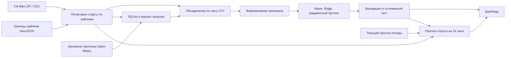

# Veloforecast

Прогнозно-аналитическая система для оценки спроса на городской велопрокат Citi Bike в Нью-Йорке. Целевой показатель — число начатых поездок за час. Горизонт прогноза — 24 часа.

## Источники данных

| Источник | Использование |
| --- | --- |
| [Citi Bike Trip History](https://citibikenyc.com/system-data) | Время и координаты старта поездок. Месячные архивы ZIP с CSV. |
| [Open-Meteo Previous Runs API](https://open-meteo.com/en/docs/previous-runs-api) | Архивные прогнозы температуры, осадков и ветра для обучения и оценки. |
| [Open-Meteo Forecast API](https://open-meteo.com/en/docs) | Погода для прогноза на ближайшие 24 часа. |
| [NYC Borough Boundary](https://services5.arcgis.com/GfwWNkhOj9bNBqoJ/arcgis/rest/services/NYC_Borough_Boundary/FeatureServer/0) | Границы пяти районов в GeoJSON. По координатам старта определяется район, затем рассчитываются доли стартов по районам. |

## Схема системы



## Подготовка на Windows

В терминале PowerShell из папки проекта:

```powershell
python -m venv .venv
.\.venv\Scripts\python.exe -m pip install -r requirements.txt
.\.venv\Scripts\python.exe -X utf8 app.py check
```

Из [официального списка архивов](https://s3.amazonaws.com/tripdata/index.html) скачайте вручную 12 месячных архивов NYC за 2025 год, от `202501-citibike-tripdata.zip` до `202512-citibike-tripdata.zip`. Поместите ZIP-файлы в `state\citibike`. Папка `state` содержит исходные данные и результаты обработки и исключена из Git.

## Сборка данных и оценка моделей

```powershell
.\.venv\Scripts\python.exe -X utf8 build_year.py
.\.venv\Scripts\python.exe -X utf8 trip_availability.py
.\.venv\Scripts\python.exe -X utf8 features.py
.\.venv\Scripts\python.exe -X utf8 model_data.py
.\.venv\Scripts\python.exe -X utf8 experiments.py
.\.venv\Scripts\python.exe -X utf8 evaluate.py
.\.venv\Scripts\python.exe -X utf8 dashboard.py
```

Дашборд доступен по адресу [http://127.0.0.1:8765](http://127.0.0.1:8765). На нём отображаются факт и прогноз по часам, качество на отложенном тесте, журнал экспериментов и интерпретация Ridge. Для остановки сервера нажмите **Ctrl+C**.

При повторной сборке используются готовые почасовые таблицы Citi Bike, а Open-Meteo запрашивается для недостающих дат. Просмотр журнала загрузок:

```powershell
.\.venv\Scripts\python.exe -X utf8 weather_store.py --log
```

## Прогноз на текущую дату

Скачайте последний доступный месячный архив NYC в `state\citibike`. В обеих командах укажите один и тот же месяц. Пример для октября 2026 года:

```powershell
.\.venv\Scripts\python.exe -X utf8 sync_trips.py --month 2026-10
.\.venv\Scripts\python.exe -X utf8 live_forecast.py --month 2026-10
```

После обновления страницы дашборд покажет 24 почасовых значения, суммарный объём, пиковый час и дату последнего факта. Citi Bike публикует поездки месячными архивами, поэтому фактическая история поступает с задержкой.